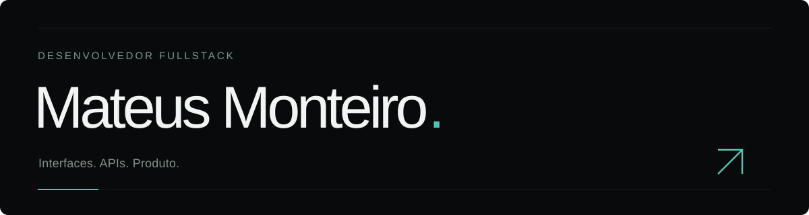

## Olá, sou o Mateus.

Desenvolvedor **fullstack júnior**, empreendedor e curioso por natureza. Trabalho com interfaces, APIs e experiências digitais, conectando tecnologia, design e visão de produto.

**[Explore meu portfólio →](https://ceomontteiro.github.io/)**

### Minha caixa de ferramentas

**Frontend** · React, Next.js, TypeScript, JavaScript, HTML, CSS e Tailwind CSS.

**Backend & dados** · Node.js, NestJS, Express, Python, FastAPI, Prisma, PostgreSQL, MongoDB e MySQL.

**Produto & processo** · Figma, UI/UX, Git, APIs REST, arquitetura em camadas e Clean Code.

### O que construo

**[Fine Form](https://fine-form-3-0.fineformcare.workers.dev/)** — projeto próprio que conecta identidade, experiência digital e operação de um negócio de estética automotiva.

**APISupplier e APIBuilder** também fazem parte da minha trajetória em backend. Os repositórios originais estão indisponíveis; conto um pouco dessas experiências no portfólio.

[Portfólio](https://ceomontteiro.github.io/) · [E-mail](mailto:ceomontteiro@gmail.com)
