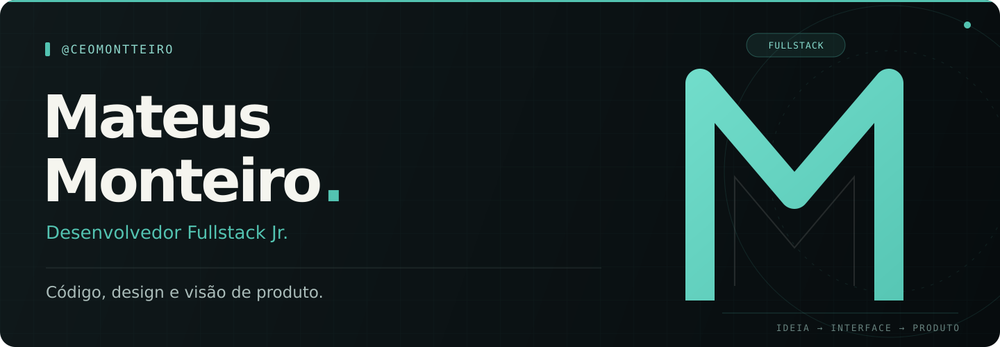
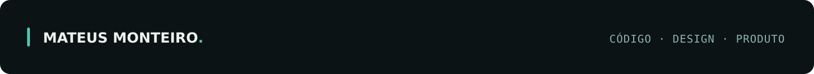

  

  <a href="#sobre-mim">Sobre mim</a> &nbsp;·&nbsp;
  <a href="#stack--tecnologias">Stack &amp; tecnologias</a> &nbsp;·&nbsp;
  <a href="#projetos">Projetos</a> &nbsp;·&nbsp;
  <a href="#vamos-conversar">Contato</a>

 

## Sobre mim

<table>
  <tr>
    <td width="73%" valign="top">
      <h3>Olá, eu sou o Mateus.</h3>
      
Sou <strong>desenvolvedor fullstack júnior</strong> e empreendedor por trás da <strong>Fine Form</strong>. Gosto de transformar necessidades reais em produtos digitais bem pensados, da primeira ideia à interface e à API.

      
Meu trabalho conecta <strong>desenvolvimento, design e visão de negócio</strong>. Participo da modelagem da solução, da prototipação e da implementação, com atenção à experiência de quem usa e à organização de quem mantém o código.

      
Tenho interesse especial em <strong>Engenharia de Software, arquitetura de sistemas e performance</strong>. Aprendo construindo, testando e pesquisando em documentações oficiais.

    </td>
    <td width="27%" align="center" valign="middle">
      
    </td>
  </tr>
</table>

### O que eu faço

- **Interfaces e experiência:** aplicações com React e Next.js, componentização, responsividade e atenção à acessibilidade.
- **APIs e dados:** serviços REST, validação de entrada, persistência e separação de responsabilidades.
- **Qualidade e evolução:** testes automatizados, análise de performance e código organizado para facilitar a manutenção.
- **Produto e design:** prototipação no Figma, design systems e decisões que conectam tecnologia ao negócio.

 

## Stack & tecnologias

  
  
  
  
  
  
  
  
  
  

| Área | Tecnologias e ferramentas |
| :--- | :--- |
| **Frontend** | React · Next.js · TypeScript · JavaScript · HTML · CSS |
| **Estilização e navegação** | Tailwind CSS · Sass · CSS Modules · React Router · Vite |
| **Backend** | Node.js · Express · NestJS · Python · FastAPI · APIs REST |
| **Dados e validação** | PostgreSQL · MongoDB · MySQL · Prisma · Zod |
| **Design e produto** | Figma · UI/UX · Prototipação · Design Systems |
| **Versionamento e infraestrutura** | Git · GitHub · Cloudflare Workers · D1 |

**Práticas que procuro aplicar:** Clean Code, SOLID, Design Patterns, arquitetura em camadas, testes automatizados, SEO, acessibilidade e análise de performance.

 

## Projetos

### Fine Form · Tecnologia aplicada ao meu próprio negócio

Projeto de estética automotiva em preparação, no qual conecto identidade visual, experiência digital e operação. A plataforma reúne apresentação dos serviços, solicitação de atendimento, acompanhamento privado, planos de cuidado e painel administrativo.

**Tecnologias do projeto:** JavaScript · HTML · CSS · Cloudflare Workers · D1 · WebSockets.

[Conhecer o site ↗](https://fine-form-3-0.fineformcare.workers.dev/) &nbsp;·&nbsp; [Explorar o código ↗](https://github.com/fineform-detailing/fineform-detailing)

### APIcustomer · API de clientes

API REST para cadastro, consulta, atualização e exclusão de clientes, com arquitetura em camadas, validação de dados e tratamento padronizado de erros HTTP. Inclui testes automatizados com mocks, Helmet, limite de payload e CORS restrito a origens autorizadas.

`Node.js` `Express` `Prisma` `MongoDB` `Zod`

### BuildSuppliers · API de fornecedores

Serviço para centralizar dados de fornecedores em uma interface HTTP consistente. O projeto inclui validação, organização em camadas e testes de carga com diferentes níveis de concorrência para analisar throughput, latência e gargalos de acesso ao banco.

`Node.js` `Express` `Prisma` `MongoDB` `Zod`

 

## Em evolução constante

Mantenho uma rotina de estudo e prática em programação, com foco em arquitetura de software, performance e construção de aplicações sustentáveis. Também desenvolvo comunicação, liderança e organização para colaborar melhor em projetos e equipes.

**Idiomas:** Português nativo · Inglês intermediário, com leitura técnica fluente · Francês básico.

 

## Vamos conversar

Gosto de trocar ideias sobre desenvolvimento web, produtos digitais, interfaces e negócios. Se quiser conversar sobre um projeto ou uma oportunidade, entre em contato.

**E-mail:** [ceomontteiro@gmail.com](mailto:ceomontteiro@gmail.com)  
**Meu projeto:** [Fine Form](https://fine-form-3-0.fineformcare.workers.dev/)

 

  

